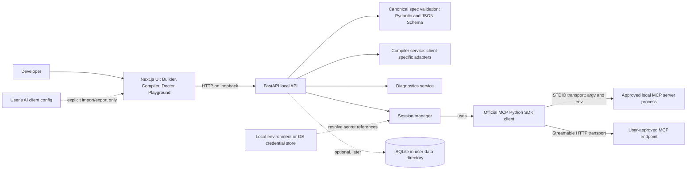

# MCPilot Architecture

## Status and goals

This document describes the target local-first architecture and distinguishes it from the current foundation. The repository contains the Next.js frontend and a minimal FastAPI service with `GET /api/health` and `POST /api/test`; it does not yet contain an MCP client, process manager, database, or live diagnostics. The broader architecture below remains proposed work.

The MVP should let one developer define an integration once, validate it, compile it for explicitly supported client targets, and safely test an MCP connection on that developer's own machine. It should remain understandable and runnable by a small team.

## System overview



## Responsibilities

### Frontend

- Keep the existing Next.js App Router, React, TypeScript, design system, and pages.
- Treat Builder and Compiler as views over the same canonical integration definition. They must not maintain separate server models or fixture lists.
- Call the local API for validation, compilation, diagnostics, and MCP sessions. Show which actions are offline and which contact or launch a server.
- Request explicit user approval before writing a client config, launching a local server, or invoking a tool.
- Never persist credentials in browser storage. Do not present environment values or secret values in previews by default.

### Local FastAPI service

- Bind to `127.0.0.1` by default. The current health/test routes are unversioned; add a versioned API namespace before expanding the service beyond this foundation.
- Validate request and response models with Pydantic and validate canonical definitions against the checked-in JSON Schema.
- Compile definitions through isolated client adapters; do not launch servers as a side effect of compilation.
- Perform static diagnostics independently from live MCP connection checks.
- Own MCP session creation, cancellation, timeouts, and cleanup. The UI must not spawn child processes.
- Resolve local secret references only at operation time. Redact credentials from logs and errors.
- Store user-created definitions locally only when persistence is introduced and the user opts in.

### MCP SDK and transports

Use the official MCP Python SDK for protocol messages, initialization, capability negotiation, tool listing, and tool calls. Pin its version because SDK major versions can introduce breaking changes. The current SDK documentation describes stdio and Streamable HTTP; its stdio guidance emphasizes that stdout is the protocol stream. Ordinary server output must not be allowed to corrupt it. [MCP Python SDK installation](https://py.sdk.modelcontextprotocol.io/get-started/installation/) · [Running an MCP server](https://py.sdk.modelcontextprotocol.io/run/)

Keep these operations separate and visible in the UI:

1. Validate the MCPilot definition.
2. Compile a target-client configuration.
3. Optionally import, export, or write a client configuration after approval.
4. Optionally launch/connect to an MCP server after approval.
5. Initialize the MCP session and negotiate protocol version/capabilities.
6. List tools and, only after a separate approval, invoke a selected tool.
7. Cancel or close the session and clean up its process/resources.

Configuration generation does not prove a connection works. A successful handshake does not prove that every tool invocation is safe.

## Component interactions and proposed API

The browser calls the local FastAPI process over loopback. The service currently binds to `127.0.0.1`, enables CORS for configured local frontend origins, and exposes the two baseline routes below. The API has no authentication and must remain a local development service. Additional routes are proposals only.

| Endpoint / proposal | Status and purpose | Side effects |
|---|---|---|
| `GET /api/health` | Implemented: return `{ "status": "ok" }`. | None |
| `POST /api/test` | Implemented: validate a message and return a backend-generated echo response. | None |
| `POST /api/v1/integrations/validate` | Proposed: validate a definition and return path-specific issues. | None |
| `POST /api/v1/configs/compile` | Compile a valid definition for one client target/version/scope. | None; never writes the target file |
| `POST /api/v1/configs/import` | Parse a user-selected config into candidate definitions. | Read only; require explicit file selection |
| `POST /api/v1/configs/export` | Prepare a target config and destination details. | No write until separately approved |
| `POST /api/v1/diagnostics` | Run selected static checks; live checks require a separate mode/approval. | Static checks are read-only |
| `POST /api/v1/sessions` | Start an approved stdio process or connect to an approved HTTP endpoint. | Starts a connection; approval required |
| `GET /api/v1/sessions/{id}/tools` | List tools from an active session. | Reads session state |
| `POST /api/v1/sessions/{id}/tools/{name}/call` | Invoke a chosen tool with user-reviewed arguments. | Executes a tool; per-call approval required |
| `DELETE /api/v1/sessions/{id}` | Cancel and close a session. | Terminates/cleans up resources |

Future route shapes should be settled in their implementation phases. Do not expose a generic endpoint that accepts arbitrary commands or shell strings.

## Data flow

1. Builder edits a canonical spec and asks the API to validate it.
2. Compiler sends the validated spec plus an explicit target identifier, supported target version, and installation scope to an adapter.
3. Adapter returns generated content, target metadata, warnings, and any unsupported fields. It does not touch the filesystem.
4. If the user chooses to write a config, show the resolved destination and a diff/merge preview; require approval, then write atomically and preserve an existing file where practical.
5. Doctor runs static checks without launching anything. Live checks require the user to select a definition and approve the server launch/connection.
6. Playground connects through a managed session, lists server-provided tools, and requires approval before a selected tool call.

## MCP session lifecycle

The session manager should maintain explicit states such as `starting`, `initializing`, `ready`, `closing`, `closed`, and `failed`, with structured diagnostics. It should:

- Resolve a stdio executable using the current process environment and `PATH`; never assume a global installation or a particular package manager.
- Before launch, require explicit approval of the resolved executable path and proposed argument list. Show the selected working directory and environment variable names; require approval again if the executable or arguments change.
- Require an explicitly selected workspace root. Resolve the working directory (including symlinks) and reject it if it is outside that root. Do not silently fall back to the MCPilot process cwd.
- Invoke the approved executable with an argument array and no shell interpolation. Pass only the required environment, with resolved secrets redacted from logs.
- For Streamable HTTP, validate scheme/host policy, use TLS for non-loopback endpoints, and keep auth material out of URLs and logs.
- Enforce startup, handshake, request, and idle timeouts; support cancellation and cleanup after errors or UI disconnects.
- Initial resource limits (configurable after testing): at most two MCP sessions that launch local stdio processes at once; retain at most 1 MiB of stderr per process; reject an individual MCP protocol message/result larger than 8 MiB. Do not collect stdout as diagnostic text; stdio stdout is the protocol stream handled by the SDK.
- Bound cleanup: ask the SDK transport to close and wait up to 3 seconds; terminate the process group/job and wait up to 2 seconds; then force-kill and wait up to 2 seconds. Report a cleanup failure if the process remains. Implement OS-specific process-group/job behavior and verify it on each target OS.
- Treat a server's tool descriptions and responses as untrusted input. Do not automatically call tools discovered from a server.

## Security boundaries

- **Origin protection:** bind only to loopback; allow only the configured MCPilot UI origin; validate `Host` and `Origin`; use a per-launch unpredictable token or equivalent request protection for state-changing operations. CORS alone is not an authorization mechanism. Reject unexpected origins and test DNS-rebinding-style hostnames.
- **Approval:** require a clear user action before client config writes, each executable launch, remote connections, and each tool invocation. Show the resolved executable, args, approved workspace and cwd, environment key names, destination/endpoint, and relevant permissions before approval. Approval is invalidated when these details change.
- **Process execution:** never use `shell=True`, shell command concatenation, or unreviewed executable paths. Enforce workspace containment for cwd, at most two concurrent local stdio processes, an 8 MiB per-message/result cap, a 1 MiB per-process stderr cap, and bounded close/terminate/kill waits as stated above. Return actionable missing-runtime errors.
- **Secrets:** accept secret references in the canonical spec, not committed secret values. Resolve from the current user's environment or a future OS credential store only when needed. Mask secret inputs; exclude secrets from previews, downloads, SQLite, exception messages, and logs unless the user explicitly requests an appropriate local export.
- **Filesystem:** use platform-aware paths; constrain generated writes to a user-approved destination; avoid following unexpected symlinks where security-sensitive; use atomic writes and backups when replacing a file.
- **Local data:** if/when SQLite is used, place it in the OS-appropriate per-user application-data directory, not the repository. Keep credentials out of the database. Provide a way to locate and remove local data.
- **Remote HTTP:** do not make outbound requests from validation or compilation. Connections are a distinct, approved operation. Apply endpoint restrictions and timeouts to reduce SSRF risk.

## Local data and portability

Each developer has independent MCP servers, environment variables, credentials, client configuration files, and local application data. MCPilot must not commit or depend on any of them. Keep sample definitions credential-free; use placeholders or secret references.

Use `pathlib` / OS APIs and a maintained platform-directory resolver if application data needs a conventional location. Never encode an original developer's home directory or absolute paths in source, examples, tests, or generated files. Paths inside a portable definition should be relative to an explicitly selected project/workspace where possible; if absolute paths are necessary, make them machine-local and clearly marked.

The frontend uses the committed `package-lock.json`; teammates install with `npm ci`. The backend must use a local Python virtual environment and a committed, pinned dependency lock/requirements artifact. `.env.example` must contain no real credentials and be committed; each machine copies it to an ignored `.env` only when local settings are needed. Setup instructions and OS verification gates are in [development setup](development-setup.md).

## Client-specific adapters

### Initial target scope (planned, not supported yet)

| Client | Planned adapter target | Verification status |
|---|---|---|
| Cursor | Project-level and/or user-level MCP configuration; exact v1 scope to be selected after format review. | Unverified. Do not claim support until the config format and OS-specific paths are verified on Windows, Linux, and macOS. |
| VS Code | Explicitly name the target harness and configuration destination; do not treat editor-managed and Copilot formats as interchangeable. | Unverified. Do not claim support until the config format and OS-specific paths are verified on Windows, Linux, and macOS. |
| Claude Desktop | Desktop application's supported MCP configuration/extension mechanism. | Unverified. Do not substitute Claude Code configuration. Do not claim support until the format and OS-specific paths are verified on Windows, Linux, and macOS. |

Do not equate MCP protocol support with client configuration compatibility. Each eventual adapter must identify client, harness/destination/scope, version or documented support range, emitted schema, transport support, and unsupported fields. Keep versioned golden fixtures and cite official client documentation used to verify them. Resolve config paths using current OS APIs and vendor documentation, never from another developer's machine. Current VS Code documentation describes distinct Copilot and editor-managed formats and a deprecation path for the latter, illustrating why harness and destination must be explicit. [Cursor MCP documentation](https://cursor.com/docs/mcp) · [VS Code MCP configuration reference](https://code.visualstudio.com/docs/agents/reference/mcp-configuration) · [Claude Desktop local MCP documentation](https://support.claude.com/en/articles/10949351-getting-started-with-local-mcp-servers-on-claude-desktop)

No client is enabled as supported until its adapter fixtures and configuration paths have been reviewed and tested for all claimed operating systems. Protocol session support is a separate capability from generating a compatible client config.

## Optional persistence

Do not add SQLite until saved definitions/history are needed. If justified, store non-secret integration metadata and schema version only; use migrations, a per-user data location, restrictive file permissions where supported, and export/delete controls. Keep configuration and credential files belonging to AI clients outside MCPilot's database.

## Proposed repository layout

Keep the current Next.js project at the Git root. Do not add another nested frontend project.

```text
MCPilot/
├── src/                         # Existing Next.js application; retain it
│   ├── app/
│   ├── components/
│   ├── features/                # Builder/compiler/doctor/playground modules as extracted
│   ├── lib/api/                 # Typed client for the local API
│   └── types/
├── backend/
│   ├── pyproject.toml           # Or pinned requirements plus a lock artifact
│   ├── .python-version          # Optional tool hint, not a machine path
│   └── src/mcpilot_api/
│       ├── main.py
│       ├── api/routes/
│       ├── schemas/
│       ├── services/compiler/
│       ├── services/diagnostics/
│       ├── services/sessions/
│       ├── security/
│       └── storage/
├── spec/
│   ├── integration.schema.json
│   └── examples/
├── docs/
├── .env.example
└── README.md
```

This is a destination structure, not a description of directories already present.
