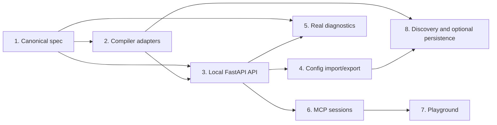

# MCPilot Implementation Roadmap

This roadmap turns the existing UI prototype into a usable local-first MVP in small, verifiable steps. It preserves the current Next.js frontend and does not claim any unfinished feature is real.

## Phase summary and dependencies

Every phase includes security and portability gates. Compatibility is not declared until the relevant clean-machine checks pass on Windows 10/11, Linux, and macOS.

## Phase 1 — Canonical integration specification and validation

**Features:** Define a versioned JSON Schema for stdio and Streamable HTTP; add Pydantic models; validate YAML imports through a real parser then normalize to the canonical model; model local secret references.

**Likely files:** `spec/integration.schema.json`, `spec/examples/*`, `docs/integration-specification.md`, `backend/pyproject.toml` or pinned requirements/lock files, `backend/src/mcpilot_api/schemas/*`, and shared frontend spec types/validators under `src/features` or `src/types`.

**Dependencies:** Python 3.11+ for the current official MCP Python SDK line; pinned Pydantic and JSON Schema dependencies; existing TypeScript/YAML packages.

**Acceptance criteria:** Both Builder and Compiler consume one model; stdio and Streamable HTTP are represented without ambiguous fields; invalid input yields structured path-specific issues; YAML round-trips with quoting, Unicode, arrays, and special characters; no validation path starts a process or contacts a URL.

**Testing requirements:** JSON Schema and Pydantic parity fixtures; valid/invalid spec unit tests; YAML edge-case tests; secret-redaction assertions; Windows/Linux/macOS path interpretation tests.

**Security and portability:** Secret refs only, no live values in fixtures; use OS-aware path APIs; no developer-specific absolute paths; verify on all target OSes before calling the schema portable.

## Phase 2 — Configuration compiler and client adapters

**Features:** Extract pure compiler functions; define planned adapters for Cursor, VS Code, and Claude Desktop; include target version/scope metadata and unsupported-field warnings. These are target clients only; none is supported until its configuration format and OS-specific paths pass documented verification on Windows, Linux, and macOS.

**Likely files:** `src/app/compiler/compiler-client.tsx`, `src/app/builder/builder-client.tsx`, new `src/features/compiler/*`, `backend/src/mcpilot_api/services/compiler/*` if compilation is server-side, `spec/fixtures/clients/*`, and `docs/client-support.md`.

**Dependencies:** Phase 1; official client documentation for each claimed target.

**Acceptance criteria:** Same canonical definition produces stable, documented output; adapter does not save files, start servers, or resolve secrets; unsupported fields are visible; all config paths are OS/destination aware. Maintain a support matrix for Cursor, VS Code harness/destination, and Claude Desktop; mark each unverified until official formats and paths are checked and adapter fixtures/manual tests pass on every claimed OS. Remove hardcoded demo integrations from the production flow.

**Testing requirements:** Golden fixture tests per adapter and target version; round-trip tests where an importer exists; tests for secret placeholders, paths, escaping, and unsupported features; manual validation of each target's config format and OS-specific config path on Windows, Linux, and macOS before marking that client/OS combination supported.

**Security and portability:** Never embed credentials unless a user explicitly approves a local-only export; path fixtures use temp directories and platform-aware helpers.

## Phase 3 — Local FastAPI backend

**Features:** Extend the existing minimal local API with typed error handling and the next API endpoints as their feature phases require. Keep it bound to loopback. Document separate frontend/backend processes.

**Likely files:** `backend/src/mcpilot_api/main.py`, `api/routes/*`, `schemas/*`, `src/lib/api/*`, `.env.example`, `.gitignore`, `docs/development-setup.md`, and `README.md`.

**Dependencies:** Phases 1–2; the basic FastAPI foundation is now present. Keep this phase's dependencies limited to a local Python virtual environment and pinned FastAPI, Uvicorn, Pydantic, and python-dotenv. Add MCP SDK, JSON Schema, or YAML packages only in the phase that first needs them; the Node/npm lockfile already exists.

**Acceptance criteria:** The existing foundation provides `GET /api/health` and `POST /api/test`, installs into `backend/.venv`, reads local config from environment variables, serves CORS to configured dev origins, and listens on `127.0.0.1`; UI handles backend unavailable state; no app code relies on developer-global packages or credentials. This minimal baseline does not include authentication or full local API security hardening; those remain follow-up work before broader exposure.

**Testing requirements:** API route tests, request validation/error tests, CORS-origin tests, and clean install/start smoke test on Windows, Linux, and macOS. Before adding side-effecting endpoints, add the origin/host/token security tests described in the architecture document.

**Security and portability:** No public bind; secrets stay local; `.env.example` has no real credentials; `.gitignore` covers `.env`, virtualenvs, caches, generated DB/data; setup instructions provide PowerShell and POSIX commands.

## Phase 4 — Client configuration import/export

**Features:** User-selected file import, parse/normalize into canonical definitions, output preview, conflict/diff view, and explicit approval before writing a target file.

**Likely files:** `src/features/compiler/*`, `src/features/builder/*`, `src/lib/api/*`, `backend/src/mcpilot_api/services/config_io/*`, and adapter fixtures.

**Dependencies:** Phases 1–3; supported client adapters from Phase 2.

**Acceptance criteria:** Import reads only a user-selected path; unknown fields are preserved or shown as dropped; export shows exact destination and diff; no overwrite occurs without approval; writes are atomic where supported.

**Testing requirements:** Parse/serialize fixture tests; malformed and unknown-field tests; conflict/backup tests; platform-specific path tests; manual checks against each documented client destination.

**Security and portability:** Restrict writes to approved destinations; reject traversal; preserve existing files; never place secrets in shared configs by default.

## Phase 5 — Real diagnostics

**Features:** Replace Doctor scenario fixtures with static checks of provided specs/configs; add optional environment checks for executables and referenced variables. Live connection checks remain clearly separate.

**Likely files:** `src/app/doctor/doctor-client.tsx`, `backend/src/mcpilot_api/services/diagnostics/*`, `backend/src/mcpilot_api/api/routes/*`, and diagnostic fixtures/tests.

**Dependencies:** Phases 1 and 3; Phase 4 for imported client configs.

**Acceptance criteria:** Every result identifies the input and check actually performed; absent checks are `not_checked`; command missing, env reference missing, malformed config, and unsupported transport produce actionable remediation; no mock “passed connection” result remains.

**Testing requirements:** Unit tests for each rule; tests distinguish static from live checks; platform-specific executable lookup tests; assert secrets never appear in messages/logs.

**Security and portability:** Static mode makes no network calls and launches no process. Environment checks are read-only and do not print values.

## Phase 6 — MCP session management and connections

**Features:** Start approved stdio processes and connect to approved Streamable HTTP endpoints using the official SDK; initialize/handshake; structured session states; timeouts, cancellation, and cleanup.

**Likely files:** `backend/src/mcpilot_api/services/sessions/*`, `security/*`, API session routes, `src/features/playground/*`, SDK lock files, and controlled test-server fixtures.

**Dependencies:** Phases 1 and 3; diagnostics from Phase 5 recommended.

**Acceptance criteria:** One reviewed test server connects on each supported OS; missing runtime message is actionable; stdout stays protocol-clean; failure/cancel/shutdown closes transports and child processes; remote auth uses secret refs and TLS; no connection starts without approval.

**Testing requirements:** SDK/in-memory tests where available; process integration tests with a controlled test server; handshake, timeout, malformed output, cancellation, and orphan-process tests on Windows, Linux, and macOS; HTTP TLS/auth policy tests.

**Security and portability:** argv only, no shell; explicit cwd/env; bounded resources and output; approved endpoint/command shown to user; secrets redacted.

## Phase 7 — Playground and tool execution

**Features:** Show session state and discovered tools; render tool input schema; require a separate approval for each invocation; display structured results/errors.

**Likely files:** `src/app/[section]/page.tsx` or a dedicated playground route, `src/features/playground/*`, session API routes, and UI tests.

**Dependencies:** Phase 6.

**Acceptance criteria:** User can connect, list tools, select a tool, review arguments, approve invocation, inspect result, and close session. No tool runs automatically on discovery or page load.

**Testing requirements:** UI workflow tests; mock session API for display states; integration test with a harmless controlled tool; test rejection/cancel and large/error responses.

**Security and portability:** Tool descriptions/results are untrusted; render as text; cap payload sizes; approval is per call and states arguments/target.

## Phase 8 — Discovery and optional persistence

**Features:** Curated discovery source with provenance and update policy; optional SQLite for non-secret saved definitions/history, if user feedback establishes the need.

**Likely files:** `src/features/discovery/*`, `backend/src/mcpilot_api/services/discovery/*`, `backend/src/mcpilot_api/storage/*`, migration files, docs, and fixtures.

**Dependencies:** Core spec, adapters, API; persistence should not block the core local workflow.

**Acceptance criteria:** Discovery results identify source and last-checked time; entries do not auto-install or execute; SQLite location is per-user and platform-aware; only non-secret data is stored; user can export and delete it.

**Testing requirements:** Registry parsing/provenance tests; stale/invalid entry tests; DB migration, backup/export/delete tests; per-user data-path tests on all target OSes.

**Security and portability:** Review supply chain before displaying install instructions; no auto-run; local data excluded from Git; never persist raw credentials.

## Cross-phase release gates

- Keep the repository root as the existing `MCPilot` Git root; do not nest another frontend app.
- Preserve the current UI and mark unfinished actions honestly.
- Use `npm ci` for clean frontend installs and a local Python venv plus pinned backend dependencies.
- Verify a clean clone on Windows 10/11, Linux, and macOS before making a cross-platform claim. Record OS/runtime versions and failures.
- Exercise security boundaries and failure paths, not only successful demos.
- Keep separate evidence for generated config validity, MCP handshake success, tool listing, and tool invocation.
