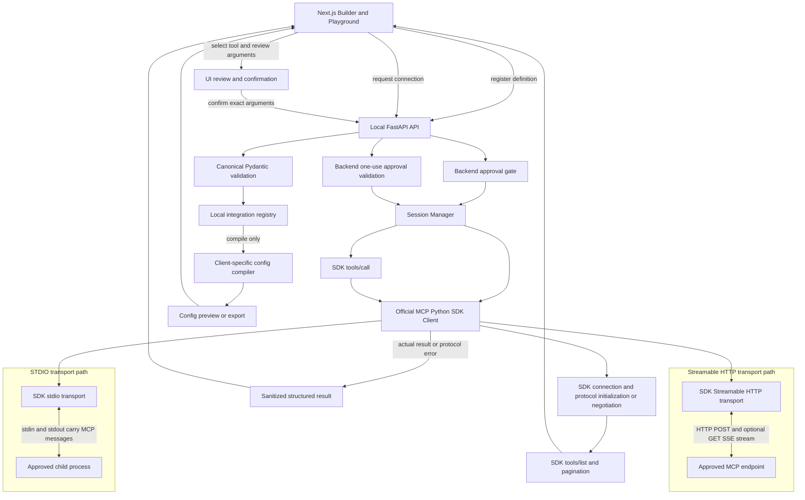

# MCPilot MCP Runtime Architecture

## Status

**Status: first STDIO slice implemented; broader design remains proposed.** `mcp==2.3.0` now powers a real local session to the bundled demo server. The backend registers the v1 canonical model in memory, requires backend-verified one-use approval before launch and each tool call, initializes the SDK client, discovers tools, and cleans up the session. Streamable HTTP, external integrations, config generation, persistent state, and diagnostics are not implemented.

The runtime uses the official MCP Python SDK as the protocol client, pinned here to `mcp==2.3.0`. The current SDK client API accepts `StdioServerParameters`, a Streamable HTTP URL/transport, or an in-process server for tests; entering its asynchronous context opens the connection and leaving closes it. The SDK exposes negotiated connection facts, paginated tool listing, and tool calls. [Python SDK client](https://py.sdk.modelcontextprotocol.io/client/) · [Python SDK client transports](https://py.sdk.modelcontextprotocol.io/client/transports/)

## Responsibility boundaries

- **Configuration generation** validates the canonical definition and produces a preview for one explicitly selected client adapter. It does not resolve secrets, launch a process, contact a URL, or prove the target client accepts the output.
- **Registration** stores a validated canonical definition in the local registry. In the first slice this registry is in memory; restart loses definitions and sessions. Registration itself does not start the server.
- **Connection** resolves the selected transport, gathers connection approval, and opens the official SDK client.
- **Initialization/negotiation** is performed by the SDK for the protocol version and peer it supports. For handshake-era protocol revisions this includes initialization and capability/version agreement. Newer supported protocol revisions can change lifecycle details; MCPilot must not reimplement the handshake or assume a remote HTTP session ID exists.
- **Tool discovery** sends SDK `tools/list` requests after a connection is ready, follows pagination, and returns the server's current schemas to the UI. It does not execute a tool.
- **Tool execution** is a separate API action requiring a reviewed argument payload and one-time user approval. Discovery or opening Playground never invokes tools automatically.
- **Disconnection** closes the SDK context, transport, and any child process and removes the ephemeral session record.

Configuration output and connection are parallel capabilities over the canonical definition, not sequential evidence. A generated config does not make a connection; a successful connection does not mean client config generation or every tool works.

## Architecture diagram

The diagram shows two mutually exclusive transport paths. STDIO launches a child process; Streamable HTTP connects to an endpoint that is already running. The session manager selects exactly one from the validated transport discriminator. Configuration compilation takes its own path and never enters the session manager.

## Registration and runtime session lifecycle

### Integration registration

The implemented API validates the submitted versioned canonical model and stores it in a local in-memory registry. It returns only safe registration metadata. Registration does not launch or connect. A backend restart clears registrations and sessions.

Implemented first-slice API boundaries (the wider API remains proposed):

| Operation | Purpose | Side effects |
|---|---|---|
| `GET /api/v1/security/token` | Issue a per-process browser request token after Host/Origin validation. | None; response is no-store. |
| `GET /api/v1/demo` | Return the portable bundled demo definition. | None. |
| `POST /api/v1/integrations` | Validate and register one canonical definition. | In-memory state only. |
| `POST /api/v1/sessions/prepare` | Resolve and return exact STDIO executable/argv/cwd plus a short-lived one-use approval. | No process launch; secrets resolve only after approval. |
| `POST /api/v1/sessions` | Consume approval, open an SDK-managed STDIO client, initialize, and discover tools. | Launches the approved child. |
| `GET /api/v1/sessions/{id}` | Return live session facts and discovered tools. | None. |
| `POST /api/v1/sessions/{id}/tools/{name}/approval` | Create approval bound to the discovered tool and exact arguments. | No tool call. |
| `POST /api/v1/sessions/{id}/tools/{name}/call` | Execute only with the unused matching approval. | Executes a server tool. |
| `DELETE /api/v1/sessions/{id}` | Close the SDK context and child process. | Cleanup. |

Routes are design suggestions, not an API commitment. Version routes before expanding the current two unversioned foundation endpoints. Do not expose a generic “run command” route.

### Session states

Use explicit states such as `registered`, `awaiting_approval`, `starting`, `connecting`, `initializing`, `discovering_tools`, `ready`, `closing`, `closed`, and `failed`. Every transition has a timestamp, safe diagnostic code, and correlation/session ID. A failed state reports which stage failed (executable resolution, launch, transport open, protocol negotiation, tool listing, invocation, or cleanup), without exposing credentials.

MCPilot's session ID is an opaque, random, local API handle. It is not an MCP `Mcp-Session-Id`; the presence/semantics of a protocol-level ID depends on the negotiated protocol and remote server. A stdio connection remains tied to its child process while open.

The manager keeps the SDK client's async context inside a per-session worker task and queues calls and close requests through that task. This keeps the SDK lifecycle in one async task and serializes operations. Since an in-memory manager cannot share clients across workers, run one FastAPI/Uvicorn worker. App shutdown closes all sessions; process restart invalidates handles.

## SDK connection and tool flow

1. **Resolve and approve.** Resolve the executable or endpoint under local policy. For STDIO, display the canonical executable path, argv as distinct entries, selected workspace/cwd, and environment variable names. For HTTP, display the exact origin, TLS status, and auth mode. Resolve secret references only after approval.
2. **Open transport.** Construct the official SDK `Client` from `StdioServerParameters` for STDIO, or from a URL/custom Streamable HTTP transport for HTTP. Construction alone is not a connection; entering the async context performs the open.
3. **Initialize/negotiate.** Let the SDK execute the protocol-version-appropriate initialization and capability negotiation. Store the negotiated protocol and server metadata when provided. Do not send handcrafted JSON-RPC or label the session ready before this succeeds.
4. **Discover tools.** Call the SDK's `list_tools()` and follow all `next_cursor` pages. Return each tool's name, title, description, and input schema as untrusted data. Refresh when the server signals tools changed or before a call if required by the pinned SDK/protocol.
5. **Review invocation.** UI renders the input schema as a form and shows the exact tool name and arguments. Backend validates the JSON shape and issues a one-use approval challenge bound to the session, tool, argument digest, and short expiry. Any change invalidates approval.
6. **Execute.** After explicit confirmation, call the SDK's `call_tool(name, arguments)`. Distinguish a normal tool result with `is_error=true` from transport/protocol exceptions; a tool failure is not necessarily a broken session. Return content blocks and structured content as typed JSON, with strict size limits.
7. **Close.** A user disconnect, session expiration, backend shutdown, connection failure, or explicit cancellation closes the SDK context and associated resources.

The SDK currently documents `Client(StdioServerParameters(...))`, `Client(url)` for Streamable HTTP, `list_tools()`, and `call_tool()`. If MCPilot provides custom HTTP headers/authentication/timeouts, use a configured `httpx2.AsyncClient` passed to the official `streamable_http_client`; do not rely on obsolete direct `headers=` or `timeout=` transport arguments. For the SDK's documented HTTP client, connect/write/pool timeouts are 30 seconds and read timeout is 300 seconds; the application must separately bound user-visible tool operations and session idle time. [SDK transport options and timeouts](https://py.sdk.modelcontextprotocol.io/client/transports/) · [SDK client result model](https://py.sdk.modelcontextprotocol.io/client/)

## Transport-specific behavior

### STDIO

- The SDK starts the configured executable as a subprocess. Pass the command and argument array separately. Never call through a shell or split/expand a command string.
- MCP JSON-RPC flows from the client to child `stdin` and from child `stdout` to the client. The server must not write ordinary logs to stdout. `stderr` is a diagnostic stream, not protocol traffic, and stderr output alone is not proof of failure. [MCP STDIO transport rules](https://modelcontextprotocol.io/specification/2025-11-25/basic/transports)
- The official SDK gives the child a minimal environment allow-list; MCPilot then overlays only explicit, validated variables and secret references. Do not copy the entire backend environment into the child.
- SDK context exit owns normal child shutdown. MCPilot must verify that pinned SDK behavior and still supervise a bounded fallback for a stuck child/tree. Use tested platform mechanisms (Unix process group/session and Windows Job Object or equivalent); do not implement a second, competing MCP subprocess transport.
- If the SDK's public process API cannot support the needed working directory, process-tree containment, output limits, or bounded close, treat that as an implementation gate: confirm supported SDK hooks or raise a versioned upstream issue/design decision before writing a raw protocol launcher.

### Streamable HTTP

- The MCP server is an independently running endpoint. The SDK carries JSON-RPC over HTTP POST and may maintain a GET/SSE stream for server messages; it does not launch a server process.
- Build auth headers and timeouts through the SDK's supported HTTP client. Bearer values come from secret references and never from URL user-info/query parameters.
- Require HTTPS for non-loopback endpoints. For local HTTP endpoints, require explicit approval. Apply outbound host/address policy to mitigate SSRF and DNS rebinding; validate the final destination and reject unsafe cross-origin redirects. The SDK documents same-origin redirects only for its Streamable HTTP transport.
- Keep the HTTP client and SDK context lifetimes aligned. If MCPilot provides the `httpx2.AsyncClient`, MCPilot must also close it; the SDK does not own a caller-supplied client.
- Bound MCP event/message and result sizes. The current SDK's default cap is 1 MiB per SSE event; increasing it needs a documented reason and tested memory limits.

## Timeouts, cancellation, errors, and cleanup

Use stage-specific finite deadlines: executable resolution/launch, protocol open/negotiation, each tool call, idle session, and maximum session lifetime. A timeout must cancel the in-flight operation, transition state once, and run cleanup. Do not rely on HTTP disconnect alone to kill a process. Cancellation behavior must be tested against the pinned SDK rather than assumed from task cancellation.

Implemented resource ceilings for the first local slice (Windows 11/Python 3.13.9 tested; other OSes not verified):

- At most **two active local STDIO processes** across sessions.
- Child stderr is redirected to the platform null device and is not retained or returned. SDK stdout is consumed as protocol data only.
- Reject discovered tool schemas and completed tool results larger than **1 MiB**. The official SDK's public STDIO API does not expose a pre-parse raw frame-size limit; an oversized single stdout line can therefore be buffered before MCPilot applies its schema/result limit.
- Enforce **30 seconds** for initialization/discovery, **30 seconds** per tool call, **10 minutes** idle, and **30 minutes** maximum session lifetime. Streamable HTTP is not implemented.
- On close, delegate subprocess-tree cleanup to the SDK STDIO context, whose documented waits are bounded and cancellation-shielded. MCPilot does not add a separate OS Job Object/process-group fallback yet.

Errors must distinguish invalid definitions, missing/unapproved executable, user denial, process launch/early exit, transport failure, version/capability negotiation failure, tool-list failure, invalid tool arguments, server tool error, result too large, timeout/cancel, and cleanup failure. Return stable codes and remediation, not Python tracebacks or raw process environments. A server-provided tool error (`is_error`) should be rendered as a tool outcome while preserving a healthy connection when possible.

## Concurrency and lifecycle ownership

- Session manager owns all client contexts, transports, HTTP clients, subprocess references exposed by the SDK, deadlines, approvals, and cleanup tasks.
- A session is an in-memory object bound to the one backend process/event loop. Use a global semaphore for the STDIO process cap and a per-session worker queue for serialized SDK operations.
- Do not run blocking work on FastAPI's event loop. Use SDK async operations and bounded I/O drains. Do not start background processes that outlive the session manager.
- On application shutdown, stop accepting new connections, cancel in-flight tool calls within deadline, close every SDK context, then terminate remaining children within the cleanup budget.
- Session cleanup must be idempotent. Repeated DELETE, timeout, app shutdown, and transport failure converge on one close path.
- Do not persist live SDK objects, resolved secrets, process IDs, or approval tokens in a database. The first slice needs no database.

## Security boundaries

1. **No arbitrary shell execution.** Use a structured executable field plus an argument array. Reject shell metacharacter parsing and do not use `shell=True`. Resolve the executable under a controlled PATH, canonicalize the resolved path, and require the user to explicitly approve that exact executable and argv. Re-resolve at launch and fail if it changed.
2. **Working directory containment.** The demo uses the repository root as its workspace and displays the resolved cwd before approval. It resolves symlinks and rejects cwd outside that root, `..`, and absolute portable cwd paths. A general user-selected root is future work.
3. **Least-privilege environment.** Start with a minimal allow-list, overlay only declared environment values, and resolve secret references at connection time. Never log or return resolved configuration secrets in API responses, generated configs, exception messages, telemetry, or stored definitions. Redact exact known secret values from stderr and tool results before returning/logging them. This cannot detect every transformed or encoded leak, so do not give a server a secret it does not need or trust.
4. **Per-action approval.** Require connection approval before launching/connecting and a separate tool approval for every call. The backend, not a frontend boolean, verifies short-lived one-use approval bound to the exact integration revision/executable or endpoint, tool, and argument digest.
5. **Bound resources.** Apply the timeouts, two-process concurrency limit, result/schema caps, session lifetime, and SDK-bounded cleanup above. The current SDK interface does not cap a raw STDIO frame before parsing; treat this as an unresolved security limitation, not as a complete process-output cap.
6. **Protect the local API.** Bind only to `127.0.0.1`. CORS is not authorization. Validate exact allowed `Host` and browser `Origin` values on every request; reject unexpected hostnames/origins (including attacker-controlled DNS-rebinding names). Protect state-changing requests with a per-process unpredictable local token or equivalent CSRF defense, and use strict content types. Do not enable wildcard origins or credentials. Verify both `localhost` and `127.0.0.1` UI origins deliberately.
7. **Protect outbound HTTP.** Connection is a separate approved action. Restrict URL schemes, inspect DNS resolution and resolved addresses, block cloud metadata/link-local and other disallowed targets, guard against DNS changes/redirects, require TLS for remote endpoints, and apply connection/read deadlines. Static validation never contacts the endpoint.
8. **Treat server data as untrusted.** Render descriptions/results as text or allow-listed structured JSON; never interpret server content as HTML/Markdown with active links or commands. Validate tool names/arguments against the discovered schema and enforce backend limits.
9. **Do not overclaim sandboxing.** A child process generally has the developer account's OS permissions. MCPilot's approval and limits reduce accidental execution but are not an OS sandbox; never imply the demo isolates a malicious server.

MCP itself does not mandate one interaction pattern, but its tool security guidance recommends keeping a human able to deny invocations and showing which tools are exposed. MCPilot intentionally chooses a stricter per-call confirmation policy for this local management UI. [MCP tool user interaction guidance](https://modelcontextprotocol.io/specification/2025-11-25/server/tools)

## Remaining verification gates

- `mcp==2.3.0` is selected and pinned. Test another server/protocol version before claiming compatibility with it.
- Verify STDIO stdout cleanliness, environment allow-listing, argument preservation, working directory, timeout, cancellation, process-tree cleanup, and output behavior on Windows 10/11, Linux, and macOS.
- Verify Streamable HTTP auth, TLS errors, same-origin redirect behavior, SSE cancellation, endpoint allow/deny rules, and size limits separately. The first vertical slice does not exercise HTTP.
- Test approval denial, approval invalidation after spec/args change, CSRF/Host/Origin rejection, DNS-rebinding-style hostnames, secret redaction, and all cleanup/error states.
- Do not claim cross-platform compatibility for an OS that has not passed its clean-machine gates.

## Remaining decisions and limitations

- Verify the SDK's documented bounded process-tree cleanup behavior on Windows, Linux, and macOS. The public STDIO API does not cap raw protocol frames before parsing.
- The browser token and exact local Host/Origin checks are implemented for the configured `localhost:3000` and `127.0.0.1:3000` frontend origins.
- A general user-selected workspace root and local executable overrides are not implemented; the demo uses the repository root and resolves its `python` alias to the active backend interpreter.
- Keep OAuth and durable integration persistence deferred unless the first demo establishes a concrete need.
